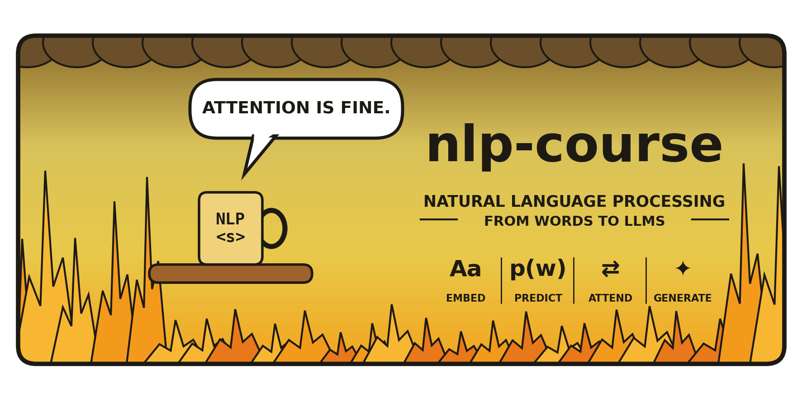

  

# Coming Soon 🚧

This page is not available yet, but it will be added before the corresponding course session.

## What will be available here?

Depending on the module, this page may later include:

- Lecture slides
- Seminar notebooks
- Homework assignments
- Code examples
- Dataset and model links
- Additional reading material

## Please check again later

Course materials are uploaded progressively during the semester.

You can return to the main course page here:

[⬅ Back to NLP Course](./index.md)

---

**Course:** Natural Language Processing  
**Date:** 2026  
**Instructor:** Assist. Prof. Emanuela Boros

---

> Good NLP takes time: first we read the data, then we model the language.
